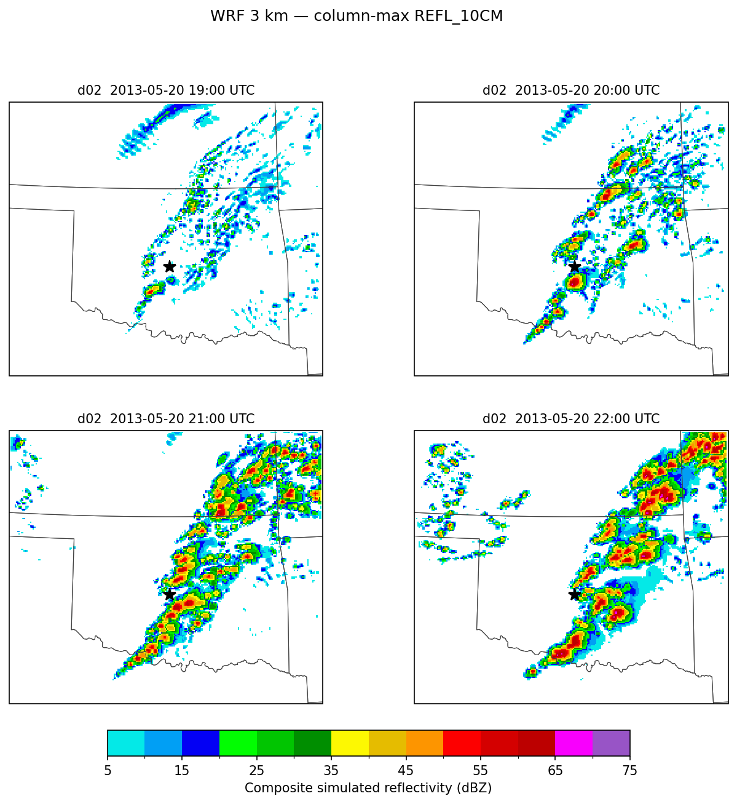
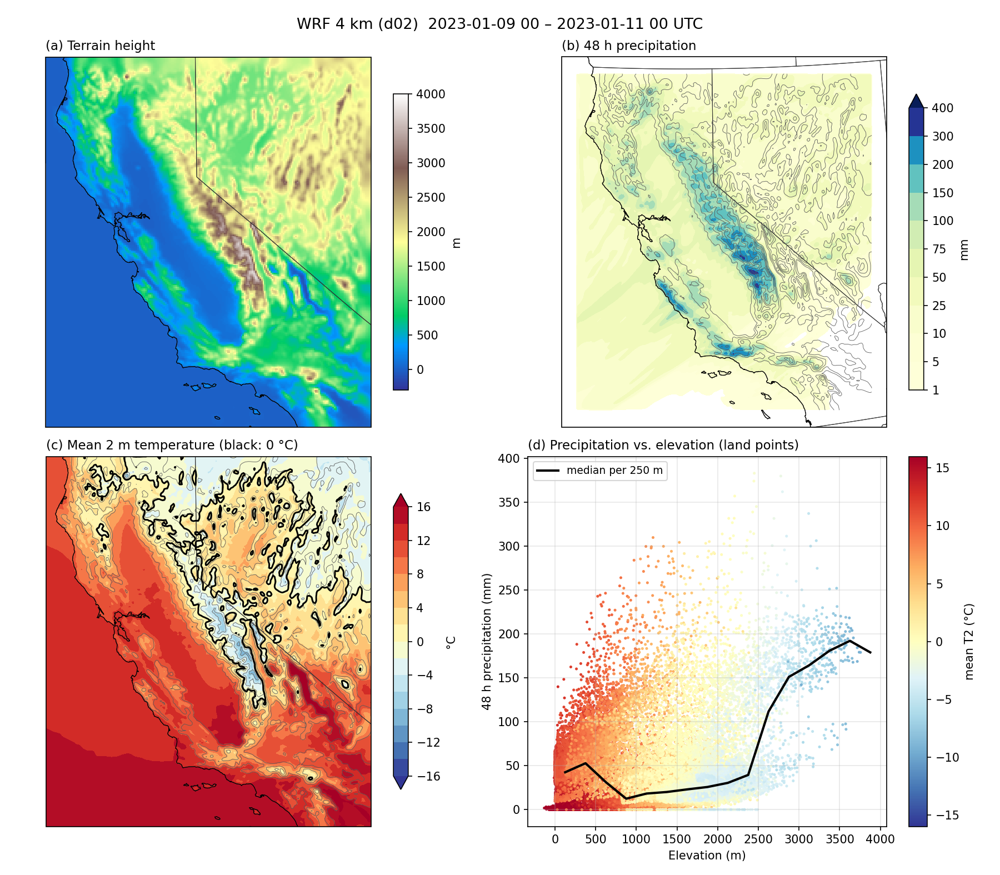

# WRF on OU OSCER Sooner — from scratch to a case study

Reproducible scripts and documentation to **build, configure and run the Weather Research and
Forecasting model (WRF-ARW v4.7.1 + WPS v4.7.0)** on the University of Oklahoma's
[OSCER](https://www.ou.edu/oscer) *Sooner* cluster (Enterprise Linux 9, SLURM), with
two complete case examples:

* **20 May 2013 Moore, Oklahoma supercells**: convection-permitting (3 km), simulated radar
* **9–11 Jan 2023 California atmospheric river**: temperature and precipitation over the
  Sierra Nevada (4 km), showing orographic enhancement and the snow line

## Quick start
```bash
bash scripts/build/01_get_source.sh            # clone WRF + WPS
jid=$(sbatch --parsable scripts/build/02_build_wrf.slurm)  # auto-picks + tests modules, then builds (~30-60 min)
sbatch --dependency=afterok:$jid scripts/build/03_build_wps.slurm

bash scripts/data/get_geog.sh                  # static data (~29 GB, /scratch) — while it compiles
bash scripts/data/get_case_data.sh cases/2013-05-20_moore   # NCEP FNL forcing

bash scripts/run/submit_case.sh cases/2013-05-20_moore      # WPS -> real -> WRF chain
```

> **[docs/00_start_here.md](docs/00_start_here.md)**: an 8-step checklist.

## Documentation
0. [Start here](docs/00_start_here.md)
1. [Access & environment](docs/01_access_and_environment.md) — EL9 container, storage, partitions
2. [Building WRF & WPS](docs/02_build.md) — toolchain, netCDF merge, configure options
3. [Input data](docs/03_data.md) — geog data, FNL, other forcing options
4. [Running the case](docs/04_run_case.md) — domain, physics, job chain, plotting
5. [Troubleshooting](docs/05_troubleshooting.md)
6. [Case 2: California atmospheric river](docs/06_case_california_ar.md): T2 + precipitation over terrain

## Repository layout
```
env/sooner_wrf.env.sh          modules + paths (single source of truth)
scripts/build/                 module check, source download, WRF & WPS build jobs
scripts/data/                  geog + FNL download (get_case_data.sh reads case.conf)
scripts/run/                   run_wps / run_real / run_wrf jobs, submit_case.sh chain
scripts/plot/                  domain map, reflectivity, T2/precip-vs-terrain plots, conda env
cases/2013-05-20_moore/        case 1: case.conf, namelist.wps, namelist.input (templates)
cases/2023-01-09_california_ar/ case 2: same structure
results/                       figures + timing summary committed after the run
```

## Workflow
```
 geog data ─┐
            ├─ geogrid ─┐
 FNL GRIB2 ─┴─ ungrib ──┴─ metgrid ──► real.exe ──► wrf.exe ──► wrfout_d0* ──► plots
 └──────── run_wps.slurm ─────────┘   run_real      run_wrf
```

## Case summaries
**Case 1: Moore supercells**

<p align="center">
  
  <br><em>Simulated composite reflectivity on the 3 km nest (★ = Moore, OK).</em>
</p>

| | d01 | d02 |
|---|---|---|
| Δx | 15 km | 3 km |
| Grid | 160 × 130 × 51 | 241 × 211 × 51 |
| Convection | Grell–Freitas | explicit |
| Period | 2013-05-20 12 UTC – 05-21 00 UTC | same (two-way) |

Thompson MP · RRTMG · YSU · Noah · FNL 1° IC/BC.

**Case 2: California atmospheric river**

<p align="center"></p>

| | d01 | d02 |
|---|---|---|
| Δx | 12 km | 4 km |
| Grid | 150 × 140 × 51 | 211 × 241 × 51 |
| Period | 2023-01-09 00 UTC – 01-11 00 UTC (48 h) | same |

Thompson · RRTMG · YSU · Noah-MP · slope/shading radiation · FNL 1°.

## Data & software credits
* WRF/WPS: Skamarock et al. (2021), *A Description of the Advanced Research WRF Model
  Version 4.3*, NCAR Tech. Note NCAR/TN-556+STR, doi:10.5065/1dfh-6p97.
* NCEP FNL analyses: doi:10.5065/D6M043C6 (NSF NCAR GDEX d083002).
* Computing: OU Supercomputing Center for Education & Research (OSCER).

## License
Scripts and docs in this repository: MIT (see `LICENSE`). WRF and WPS are distributed
separately under their own public-domain notice.
